# AKILLI KAFE VE RESTORAN YÖNETİM OTOMASYONU (POS, MUTFAK ENTEGRASYONU VE FİNANSAL RAPORLAMA SİSTEMİ)
## Kapsamlı Mimari, Teknik Analiz, Sektörel İnovasyon, Yönetim İşlevleri ve OWASP Güvenlik Raporu

---

## 📋 İÇİNDEKİLER

1. [Giriş ve Projenin Vizyonu](#1-giriş-ve-projenin-vizyonu)
2. [Sektörel Problem Analizi: Geleneksel POS ve Restoran Yazılımlarının Eksikleri](#2-sektörel-problem-analizi-geleneksel-pos-ve-restoran-yazılımlarının-eksikleri)
3. [Projenin Sektörde Kapatmayı Hedeflediği Boşluklar ve İnovatif Çözümleri](#3-projenin-sektörde-kapatmayı-hedeflediği-boşluklar-ve-inovatif-çözümleri)
4. [Kullanılan Mimari Yapı, Teknolojiler ve Bileşenler](#4-kullanılan-mimari-yapı-teknolojiler-ve-bileşenler)
5. [Veritabanı Mimarisi (Relational Database Schema) ve İlişkisel Veri Modeli](#5-veritabanı-mimarisi-relational-database-schema-ve-ilişkisel-veri-modeli)
    - 5.1. Varlık-İlişki (Entity-Relationship - ER) Diyagramı
6. [Modül Modül Detaylı Sistem İncelemesi](#6-modül-modül-detaylı-sistem-incelemesi)
    - 6.1. Güvenli Giriş ve Kimlik Doğrulama Modülü (`LoginFrom` & `SecurityHelper`)
    - 6.2. Merkez Ana Kontrol Üssü ve Rol Bazlı Menü Modülü (`MainFrom`)
    - 6.3. Dinamik Masa Yönetimi ve Rezervasyon Güvenlik Modülü (`MasalarTabPage` & `panelMasaKontrol`)
    - 6.4. Akıllı ve Dokunmatik Dostu Sipariş Yönetim Modülü (`SiparişlerForm`)
    - 6.5. Gerçek Zamanlı Mutfak ve Hazırlık Takip Modülü (`MutfakTabPage`)
    - 6.6. DERİNLEMESİNE YÖNETİCİ VE İDARİ İŞLEMLER MODÜLÜ (`AltMenuControl` & `YonetimTabPage`)
        - 6.6.1. Personel Yönetimi ve Pozisyon / Yetki Atama İşlemleri (`IslemlerPTabPage`)
        - 6.6.2. Personel Kriptografik Şifre Güncelleme İşlemleri (`Kaydet2_Click`)
        - 6.6.3. Menü Kategori Yönetimi ve Fotoğraf Yolu Entegrasyonu (`IslemlerKTabPage`)
        - 6.6.4. Ürün Tanımlama, Kategori Eşleştirme ve Resim Yükleme (`IslemlerUTabPage`)
        - 6.6.5. Enflasyon ve Maliyet Bazlı Dinamik Fiyat Güncelleme Modülü (`UrunGuncelKaydetBtn`)
        - 6.6.6. Salon ve Masa Kontrol Paneli: Manuel Durum Kırma ve İdari Düzenleme (`panelMasaKontrol`)
    - 6.7. Gelişmiş Finansal Raporlama, Anlık Ciro ve Sanal PDF Çıktı Modülü (`RaporlarTabPage`)
7. [Arayüz (UI) ve Ekran Bazlı Detaylı İnceleme (Görsel Referanslar)](#7-arayüz-ui-ve-ekran-bazlı-detaylı-inceleme-görsel-referanslar)
    - 7.1. Lisans ve Donanım Aktivasyon Ekranı (`LisansKontrol`)
    - 7.2. Güvenli Giriş Ekranı (`LoginFrom`)
    - 7.3. Merkez Ana Kontrol Üssü (`MainFrom`)
    - 7.4. Masalar ve Dinamik Durum Ekranı (`MasalarTabPage`)
    - 7.5. Dokunmatik Sipariş ve Ödeme Ekranı (`SiparişlerForm`)
    - 7.6. Gerçek Zamanlı Mutfak Takip Ekranı (`MutfakTabPage`)
    - 7.7. Yönetim - Personel İşlemleri Ekranı (`IslemlerPTabPage`)
    - 7.8. Yönetim - Kategori İşlemleri Ekranı (`IslemlerKTabPage`)
    - 7.9. Yönetim - Ürün İşlemleri Ekranı (`IslemlerUTabPage`)
    - 7.10. Finansal Raporlar ve Ciro Ekranı (Genel Arayüz)
    - 7.11. X Raporu (Gün İçi Nakit/Kredi Kartı Kırılımı) Çıktısı
    - 7.12. Aylık Finansal Bilanço ve Analiz Çıktısı
    - 7.13. Yıllık Rapor ve Kümülatif Ciro Çıktısı
8. [Arayüz Tasarımı (UI/UX), Dinamik Kart Mimarisi ve Responsive Yerleşim Düzeni](#8-arayüz-tasarımı-uiux-dinamik-kart-mimarisi-ve-responsive-yerleşim-düzeni)
9. [Sistem Güvenliği ve OWASP Top 10 Standartlarına Uygunluk Analizi](#9-sistem-güvenliği-ve-owasp-top-10-standartlarına-uygunluk-analizi)
    - 9.1. OWASP A03:2021 – Injection (SQL Injection Koruması ve Parametrik Sorgular)
    - 9.2. OWASP A02:2021 – Cryptographic Failures (SHA-256 Şifre Hashleme)
    - 9.3. OWASP A01:2021 – Broken Access Control (Katmanlı Yetki Kontrolü ve RBAC)
    - 9.4. OWASP A04:2021 – Insecure Design (İş Kuralları ve Rezervasyon Güvenliği)
    - 9.5. OWASP A08:2021 – Software and Data Integrity Failures (ACID ve SqlTransaction Koruması)
    - 9.6. OWASP A09:2021 – Security Logging & Exception Handling (Hata Yönetimi ve Kararlılık)
    - 9.7. Yazılım Lisanslama ve Donanım Kilidi Mimarisi (`LisansKontrol` & HWID Binding)
    - 9.8. Tersine Mühendislik, Debugger ve RAM Dökümü Engelleme Kalkanı (`AntiReverseEngineering`)
10. [Eşzamanlılık (Concurrency), İşlem Tutarlılığı (ACID) ve Veri Bütünlüğü](#10-eşzamanlılık-concurrency-işlem-tutarlılığı-acid-ve-veri-bütünlüğü)
11. [İş Kuralları (Business Logic), Veritabanı Kısıtları ve Hata Yönetimi](#11-iş-kuralları-business-logic-veritabanı-kısıtları-ve-hata-yönetimi)
12. [Performans Optimizasyonu ve Kaynak Yönetimi (`IDisposable` & Bağlantı Yönetimi)](#12-performans-optimizasyonu-ve-kaynak-yönetimi-idisposable--bağlantı-yönetimi)
13. [İleri Seviye Veritabanı Nesneleri: Stored Procedures, Triggers ve Views Kullanımı](#13-i̇leri-seviye-veritabanı-nesneleri-stored-procedures-triggers-ve-views-kullanımı)
14. [Sonuç, Değerlendirme ve Gelecek Vizyonu](#14-sonuç-değerlendirme-ve-gelecek-vizyonu)

---

## 1. GİRİŞ VE PROJENİN VİZYONU

Günümüzde yiyecek ve içecek (F&B - Food & Beverage) sektöründe operasyonel hız, hatasız servis, müşteri memnuniyeti ve finansal şeffaflık bir işletmenin hayatta kalabilmesi ve karlılığını artırabilmesi için en temel unsurlardır. Kafe ve restoran işletmeleri; salon garsonları, mutfak aşçıları, kasa personelleri ve işletme yöneticilerinden oluşan çok katmanlı, yoğun ve zamanla yarışılan bir ekosisteme sahiptir.

**Akıllı Kafe ve Restoran Yönetim Otomasyonu**, geleneksel satış noktası (POS) sistemlerinin hantal, karmaşık ve entegrasyondan uzak yapısını kırmak; salon, mutfak ve yönetim birimlerini tek bir merkezi, güvenli ve gerçek zamanlı platformda buluşturmak amacıyla geliştirilmiş kurumsal düzeyde bir .NET Windows Forms masaüstü uygulamasıdır.

Bu proje, yalnızca bir sipariş giriş ekranı olmanın çok ötesindedir. İşletme içindeki tüm rol sahiplerinin (Yönetici, Garson, Kasiyer, Mutfak Personeli) ihtiyaçlarını karşılayan; **rol bazlı erişim denetimine (RBAC)** sahip, **bankacılık düzeyinde işlem güvenliği (`SqlTransaction`)** sunan, **rezervasyon ihlallerini sistemsel olarak engelleyen**, **OWASP güvenlik standartlarını** kod mimarisinin merkezine oturtan, **yöneticilere menü/fiyat/personel üzerinde sınırsız ve esnek denetim gücü veren** ve **nakit/kredi kartı kırılımlı detaylı finansal raporlamalar** üretebilen bütüncül bir işletme otomasyon platformudur.

---

## 2. SEKTÖREL PROBLEM ANALİZİ: GELENEKSEL POS VE RESTORAN YAZILIMLARININ EKSİKLERİ

Sektörde yaygın olarak kullanılan mevcut yerli ve yabancı kafe/restoran yazılımları incelendiğinde, işletmelerin günlük operasyonlarında ciddi zaman ve para kaybına neden olan şu temel problemler tespit edilmiştir:

1. **Karmaşık, Çağdışı ve Eğitimi Zor Arayüzler (UI/UX Problemleri):**
   - Sektördeki birçok POS yazılımı 1990'ların sonu ve 2000'lerin başındaki gri, karmaşık ve küçük butonlu arayüz tasarımlarını sürdürmektedir.
   - Dokunmatik ekranlarda (Touchscreen) küçük yazılar okunamamakta, butonlara yanlış basılmakta ve yeni işe giren bir garsonun sistemi öğrenmesi günler sürmektedir.

2. **Garson ve Mutfak Arasındaki İletişim Kopukluğu ve Sıra Hatası:**
   - Kağıt adisyonlarla mutfağa sipariş taşınması, siparişin kaybolmasına veya yanlış okunmasına yol açmaktadır.
   - Dijital sistemlerin çoğunda ise yeni eklenen siparişler listenin rastgele yerlerine girildiği için mutfak personeli hangi siparişin önce geldiğini ayırt edememekte, müşteri masalarında gecikme ve memnuniyetsizlik yaşanmaktadır.

3. **Rezerve Masalara Yanlışlıkla Müşteri Alınması ve Operasyonel Kaos:**
   - Mevcut sistemlerde masanın üzerinde sadece "Rezerve" yazması, yoğun saatlerde garsonun yanlışlıkla o masaya adisyon açmasını ve sipariş girmesini engellememektedir.
   - Sipariş girildikten sonra rezervasyon sahibi geldiğinde masa dolu çıkmakta, bu durum işletme için büyük bir prestij kaybı yaratmaktadır.

4. **İdari ve Menü Yönetiminde Hantallık (Yönetici Bağımlılığı ve Kod/Yazılımcı Müdahalesi):**
   - Eski nesil sistemlerde menüye yeni bir yemek eklemek, bir ürünün fotoğrafını değiştirmek, enflasyona bağlı fiyat güncellemesi yapmak veya işe yeni başlayan bir personeli sisteme tanımlamak için yazılım firmasına ulaşmak veya veritabanı üzerinde karmaşık SQL komutları çalıştırmak gerekmektedir.
   - Bu durum işletmenin anlık esnekliğini elinden almakta, operasyonel hız kesmekte ve servis maliyetlerini artırmaktadır.

5. **Veri Tutarsızlıkları ve Eşzamanlılık (Concurrency) Hataları:**
   - Aynı masaya farklı terminallerden sipariş girildiğinde veya masadan ödeme alındığında, eski sistemlerde veritabanı işlemleri (Transaction) doğru yönetilmediği için toplam hesap tutarı yanlış hesaplanmakta veya "yarıda kesilen" işlemler veritabanında bozuk veri (Corrupt Data) oluşturmaktadır.

6. **Güvenlik Açıkları ve Açık Metin (Plaintext) Şifre Saklama:**
   - Sektördeki birçok yerel POS yazılımı, garson ve yönetici şifrelerini veritabanında açık metin (örneğin: `sifre = '12345'`) olarak tutmaktadır. Veritabanı yedeğine erişen kötü niyetli bir çalışan, yönetici şifresini öğrenerek geçmiş adisyonları silebilir veya ciro üzerinde manipülasyon yapabilir.
   - Sorguların dize birleştirme (`String Concatenation`) ile yazılması nedeniyle sistemler SQL Injection saldırılarına karşı savunmasızdır.

7. **Yetersiz ve Sabit Finansal Raporlama:**
   - Sadece günlük toplam ciroyu gösteren tek satırlık raporlar işletme yöneticisi için yetersizdir. Nakit ile Kredi Kartı tahsilatlarının ayrıştırılmaması, X raporu (gün içi anlık durum), Z raporu (gün sonu kapatma) ve yıllık/aylık kırılımların alınamaması stratejik kararları zorlaştırmaktadır.

---

## 3. PROJENİN SEKTÖRDE KAPATMAYI HEDEFLEDİĞİ BOŞLUKLAR VE İNOVATİF ÇÖZÜMLERİ

Geliştirdiğimiz otomasyon sistemi, yukarıda tanımlanan sektörel darboğazları doğrudan hedefleyerek çözüme kavuşturmaktadır:

| Sektörel Problem | Projemizin İnovatif ve Mimari Çözümü | Sağlanan İşletme Faydası |
| :--- | :--- | :--- |
| **Hantal ve Çağdışı Arayüzler** | **İki Bölmeli Modern Kart Mimarisi & 3D Dokunma Efektleri:** Üstte kristal netliğinde fotoğraf, altta yüksek kontrastlı beyaz/altın sarısı okunaklı metin şeridi. Fare/parmak temasında 3D büyüme ve basılma animasyonları. | **Sıfır Eğitim Süresi:** Garsonların ilk dakikadan itibaren hatasız, hızlı ve keyifle sipariş girebilmesi. |
| **Mutfak Sıralama Karmaşası** | **Kronolojik Kuyruk & Anlık Durum Döngüsü:** Eklenen her yeni sipariş kesinlikle adisyonun ve mutfak listesinin **en altına** kronolojik sırayla eklenir. `Hazırlanıyor` -> `Hazır` -> `Tamamlandı` durum döngüsü tam senkronize çalışır. | **Adil ve Hızlı Servis:** İlk giren siparişin ilk çıkması (`FIFO`) garanti edilir, mutfaktaki kargaşa sıfırlanır. |
| **Rezerve Masaya Sipariş Girilmesi** | **Sistemsel Rezervasyon Kilidi:** Bir masa `Rezerve` statüsündeyse, sistem garsonun o masaya sipariş eklemesini ve adisyon açmasını anında kilitler (`BeginInvoke -> Close`). Masa durumu `Boş` yapılmadan işlem yapılamaz. | **Sıfır Müşteri Mağduriyeti:** Rezervasyon sahiplerinin masalarının korunması ve operasyonel hataların tamamen önüne geçilmesi. |
| **İdari ve Menü Yönetiminde Hantallık** | **Tam Özerk Yönetim Üssü (`YonetimTabPage`):** Yöneticiler tek tıkla yeni personel atayabilir, pozisyon/şifre güncelleyebilir, yeni kategoriler/ürünler oluşturabilir, fotoğraf ekleyebilir ve tek alandan fiyat değiştirebilir. | **Sıfır Dış Bağımlılık:** İşletmenin yazılımcıya ihtiyaç duymadan tüm menü, kadro ve fiyatlandırmasını anlık yönetebilmesi. |
| **Veritabanı Tutarsızlıkları** | **ACID Uyumlu `SqlTransaction` Mimarisi:** Sipariş ekleme, ödeme alma ve iptal işlemlerinde hem `Siparis` hem de `Masalar` tablosu tek bir atomik işlem bütünlüğünde güncellenir. Hata anında `Rollback` ile tüm işlem geri alınır. | **Finansal Doğruluk:** Kasa hesabı ile adisyon tutarlarının her zaman kuruşu kuruşuna eşit olması. |
| **Şifre Sızıntıları ve SQL Injection** | **SHA-256 Kriptografik Hashlama & %100 Parametrik Sorgular:** Şifreler tek yönlü SHA-256 özetlemesiyle saklanır. Tüm veritabanı sorguları (`124+ sorgu`) `Parameters.AddWithValue` ile korunur. | **Tam Veri Güvenliği:** OWASP standartlarına tam uyum, dış ve iç siber tehditlere karşı maksimum direnç. |
| **Yetersiz Raporlama** | **Detaylı Finansal Döküm & Sanal PDF Raporlama:** Anlık ciro göstergesi, Nakit ve Kredi Kartı kırılımlı detaylı tablo, X Raporu, Z Raporu, Aylık ve Yıllık finansal özetlerin tek tıkla sanal PDF/HTML belgesine dönüştürülmesi. | **Stratejik Yönetim:** Yöneticilerin nakit akışını ve satış performansını şeffafça denetleyebilmesi. |

---

## 4. KULLANILAN MİMARİ YAPI, TEKNOLOJİLER VE BİLEŞENLER

Projemiz, kurumsal masaüstü uygulamalarında yüksek performans, donanım uyumluluğu ve kararlılık sunan katmanlı bir mimari yaklaşımla tasarlanmıştır.

```
+-----------------------------------------------------------------------------------+
|                            SUNUM KATMANI (UI / UX)                                |
|  Windows Forms (WinForms), Dinamik Panel/Card Layout, Responsive Event Handlers   |
+-----------------------------------------------------------------------------------+
                                         |
                                         v
+-----------------------------------------------------------------------------------+
|                         İŞ KURALLARI KATMANI (BUSINESS LOGIC)                     |
|  Yetki Denetimi (RBAC), Rezervasyon Kilidi, Toplam Tutar ve Ciro Hesaplamaları    |
+-----------------------------------------------------------------------------------+
                                         |
                                         v
+-----------------------------------------------------------------------------------+
|                         GÜVENLİK VE KRİPTOGRAFİ KATMANI                           |
|  SecurityHelper (SHA-256 Hash), Input Validation, Parameterized Query Generation  |
+-----------------------------------------------------------------------------------+
                                         |
                                         v
+-----------------------------------------------------------------------------------+
|                      VERİ ERİŞİM KATMANI (DATA ACCESS LAYER)                      |
|  ADO.NET (SqlConnection, SqlCommand, SqlTransaction, SqlDataReader, SqlDataAdapter)|
+-----------------------------------------------------------------------------------+
                                         |
                                         v
+-----------------------------------------------------------------------------------+
|                         VERİTABANI KATMANI (DATABASE)                             |
|  Microsoft SQL Server (Kafem Veritabanı - İlişkisel Tablolar ve Constraint'ler)  |
+-----------------------------------------------------------------------------------+
```

### 💻 Teknolojik Altyapı Detayları:
- **Geliştirme Dili:** C# (C-Sharp), .NET Framework 4.7.2+ nesne yönelimli programlama (OOP) prensipleri (Encapsulation, Inheritance, Polymorphism).
- **Arayüz Teknolojisi:** Windows Forms (WinForms). Kullanıcı arayüzü, standart statik bileşenler yerine çalışma zamanında (`Runtime`) dinamik olarak türetilen `Panel`, `PictureBox`, `Label` ve `FlowLayoutPanel` bileşenleriyle modern kart tabanlı bir yapıda kurgulanmıştır.
- **Veri Erişim Teknolojisi:** ADO.NET (`System.Data.SqlClient`). ORM (Object-Relational Mapping) araçlarının getirdiği fazladan bellek ve işlemci yükünden kaçınmak, veritabanı sorguları üzerinde milisaniyelik tam kontrol sağlamak ve işlem bütünlüğünü (`Transaction`) doğrudan yönetmek amacıyla saf ADO.NET tercih edilmiştir.
- **Veritabanı Motoru:** Microsoft SQL Server (MSSQL). İlişkisel veritabanı yönetim sistemi (RDBMS) olarak yüksek eşzamanlılık desteği ve güvenilirliği nedeniyle kullanılmıştır.
- **Kriptografi API:** `System.Security.Cryptography.SHA256` sınıfı üzerinden FIPS uyumlu tek yönlü şifre özetleme (Hashing).

---

## 5. VERİTABANI MİMARİSİ (RELATIONAL DATABASE SCHEMA) VE İLİŞKİSEL VERİ MODELİ

Sistemimiz, `Kafem` adını taşıyan, 3. Normal Form (3NF) kurallarına uygun olarak tasarlanmış 5 ana ilişkisel tablodan oluşmaktadır. Tablolar arasındaki birincil anahtar (`Primary Key`) ve yabancı anahtar (`Foreign Key`) ilişkileri veri tutarlılığını garanti altına alır.

### 5.1. Varlık-İlişki (Entity-Relationship - ER) Diyagramı
Aşağıdaki şema, sistemin kalbini oluşturan ilişkisel veritabanı yapısının görsel bir haritasıdır. Verilerin birbirleriyle nasıl konuştuğunu ve referansal bütünlük (Referential Integrity) kısıtlamalarını bu tabloda görebilirsiniz:

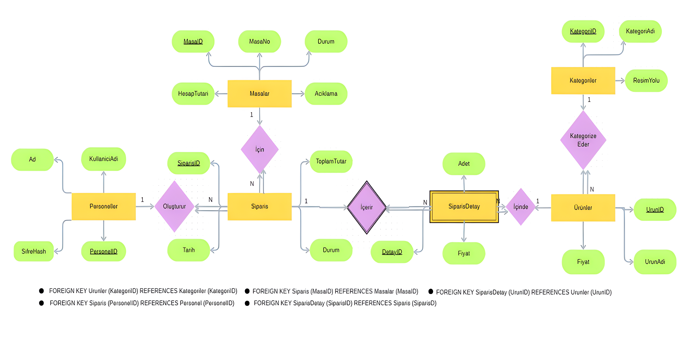
*(Görsel: SQL Server üzerinde çalışan Kafem veritabanının Entity-Relationship şeması)*

```text
+-------------------+       +--------------------+       +-------------------+
|    Kategoriler    |       |      Urunler       |       |     Personel      |
+-------------------+       +--------------------+       +-------------------+
| PK KategoriID     |<------+ FK KategoriID      |       | PK PersonelID     |
|    KategoriAdi    |       | PK UrunID          |       |    Ad             |
|    ResimYolu      |       |    UrunAdi         |       |    Soyad          |
+-------------------+       |    Fiyat           |       |    Pozisyon       |
                            |    ResimYolu       |       |    Sifre (SHA256) |
                            +--------------------+       +-------------------+
                                      ^
                                      |
                                      | FK UrunID
+-------------------+       +--------------------+
|      Masalar      |       |      Siparis       |
+-------------------+       +--------------------+
| PK MasaID         |<------+ FK MasaID          |
|    MasaAdi        |       | PK SiparisID       |
|    Durum          |       |    Adet            |
|    HesapTutari    |       |    BirimFiyat      |
+-------------------+       |    ToplamTutar     |
                            |    Durum           |
                            |    SiparisZamani   |
                            |    OdemeTuru       |
                            +--------------------+
```

### 🗄️ Tablo Yapıları ve Sorumlulukları:

1. **`Personel` Tablosu:**
   - **Alanlar:** `PersonelID` (INT, Identity, PK), `Ad` (NVARCHAR), `Soyad` (NVARCHAR), `Pozisyon` (NVARCHAR), `Sifre` (NVARCHAR(64)).
   - **Sorumluluk:** Sistemdeki kullanıcıların kimlik ve rol bilgilerini tutar. `Pozisyon` alanı (`Yönetici`, `Garson`, `Kasiyer`, `Mutfak`) rol bazlı yetkilendirmede belirleyicidir. `Sifre` alanı, 64 karakterlik hexadecimal SHA-256 özetini saklar.

2. **`Kategoriler` Tablosu:**
   - **Alanlar:** `KategoriID` (INT, Identity, PK), `KategoriAdi` (NVARCHAR), `ResimYolu` (NVARCHAR).
   - **Sorumluluk:** Menüdeki yemek ve içecek gruplarını (Örn: Kahvaltılar, Başlangıçlar, Ana Yemekler, Sıcak İçecekler) sınıflandırır.

3. **`Urunler` Tablosu:**
   - **Alanlar:** `UrunID` (INT, Identity, PK), `UrunAdi` (NVARCHAR), `Fiyat` (DECIMAL(18,2)), `KategoriID` (INT, FK), `ResimYolu` (NVARCHAR).
   - **Sorumluluk:** Satışı yapılan ürünlerin güncel birim fiyatlarını, isimlerini, fotoğraflarını ve bağlı oldukları kategoriyi tanımlar.

4. **`Masalar` Tablosu:**
   - **Alanlar:** `MasaID` (INT, Identity, PK), `MasaAdi` (NVARCHAR), `Durum` (NVARCHAR), `HesapTutari` (DECIMAL(18,2)).
   - **Sorumluluk:** Restoran salonundaki masaların anlık durumunu (`Boş`, `Dolu`, `Rezerve`) ve o masada açık bulunan siparişlerin kümülatif toplam tutarını önbellekler.

5. **`Siparis` Tablosu:**
   - **Alanlar:** `SiparisID` (INT, Identity, PK), `MasaID` (INT, FK), `UrunID` (INT, FK), `Adet` (INT), `BirimFiyat` (DECIMAL(18,2)), `ToplamTutar` (DECIMAL(18,2)), `Durum` (NVARCHAR), `SiparisZamani` (DATETIME), `OdemeTuru` (NVARCHAR).
   - **Sorumluluk:** İşletmenin tüm adisyon ve satış trafiğinin kalbidir. `Durum` alanı siparişin yaşam döngüsünü (`Hazırlanıyor`, `Hazır`, `Tamamlandı`, `İptal`) takip eder. `OdemeTuru` alanı (`Nakit`, `Kredi Kartı`), ödemesi alınarak kapatılan (`Tamamlandı`) siparişlerin finansal kırılımını sağlar.

---

## 6. MODÜL MODÜL DETAYLI SİSTEM İNCELEMESİ

Projemiz; her biri kendi içinde yüksek uyuma (`High Cohesion`) ve modüller arası düşük bağımlılığa (`Low Coupling`) sahip 7 ana modülden oluşmaktadır.

### 6.1. Güvenli Giriş ve Kimlik Doğrulama Modülü (`LoginFrom` & `SecurityHelper`)
- **İşlev:** Kullanıcı ad, soyad ve şifre bilgilerini alarak veritabanında doğrular.
- **Teknik ve Güvenlik İşleyişi:**
  1. Kullanıcı şifreyi girdiğinde `SecurityHelper.HashPassword(girilenSifre)` metodu tetiklenir.
  2. Veritabanına kesinlikle açık metin şifre gönderilmez. SQL sorgusu parametrik olarak oluşturulur:
     ```csharp
     SqlCommand cmd = new SqlCommand("SELECT Pozisyon FROM Personel WHERE Ad=@ad AND Soyad=@soyad AND Sifre=@sifre", con);
     cmd.Parameters.AddWithValue("@ad", ad);
     cmd.Parameters.AddWithValue("@soyad", soyad);
     cmd.Parameters.AddWithValue("@sifre", hashedSifre);
     ```
  3. Doğrulama başarılı olursa, personelin pozisyonu (`Yönetici`, `Garson` vb.) `MainFrom` yapıcı metoduna (`Constructor`) aktarılır ve oturum başlatılır.

### 6.2. Merkez Ana Kontrol Üssü ve Rol Bazlı Menü Modülü (`MainFrom`)
- **İşlev:** Oturum açan kullanıcının pozisyonuna göre arayüzdeki menü butonlarını dinamik olarak şekillendirir.
- **Katmanlı Yetkilendirme (`RBAC`) Mantığı:**
  - `MainFrom.cs` içerisinde tanımlanan `YetkiKontrol()` ve `YoneticiYetkisiKontrolEt()` fonksiyonları, her sekme geçişinde ve hassas işlem butonuna basıldığında tetiklenir.
  - **Yönetici:** Masalar, Yönetim (Personel, Kategori, Ürün), Mutfak ve Raporlar dahil tüm sekmelere sınırsız erişir.
  - **Garson:** Yalnızca `Masalar` ekranını görebilir ve sipariş girebilir. Ürün ekleyemez, fiyat değiştiremez, ciro raporlarına erişemez.
  - **Kasiyer:** `Masalar` ekranından ödeme alabilir ve `Raporlar` ekranını inceleyebilir.
  - **Mutfak Personeli:** Yalnızca `Mutfak` sekmesine erişerek sipariş hazırlık süreçlerini yönetebilir.

### 6.3. Dinamik Masa Yönetimi ve Rezervasyon Güvenlik Modülü (`MasalarTabPage` & `panelMasaKontrol`)
- **İşlev:** Salon masalarını görsel butonlar halinde listeler ve renk kodlarıyla anlık durumlarını yansıtır.
- **Görsel Renk Kodlaması:**
  - 🟢 **Yeşil (`Color.FromArgb(39, 174, 96)`)**: `Boş` masa. Yeni müşteri alınabilir.
  - 🔴 **Kırmızı (`Color.FromArgb(192, 57, 43)`)**: `Dolu` masa. Üzerinde aktif sipariş vardır, tıklanarak adisyona yeni ürün eklenebilir veya ödeme alınabilir.
  - 🟠 **Turuncu (`Color.FromArgb(211, 84, 0)`)**: `Rezerve` masa. Müşteri tarafından önceden ayırtılmıştır.
- **Rezervasyon Kilidi Mimarisi (`SiparişlerForm` Giriş Denetimi):**
  Bir garson `Rezerve` durumundaki masaya tıkladığında, `SiparişlerForm` açıldığı an (Load olayında) şu güvenlik engeli devreye girer:
  ```csharp
  if (_masaDurumu.Trim().ToLower() == "rezerve")
  {
      MessageBox.Show("Bu masa şu anda 'REZERVE' durumundadır!\n\nRezerve edilmiş bir masaya sipariş ekleyebilmek veya müşteri alabilmek için öncelikle 'Masaları Düzenle' panelinden masanın durumunu 'Boş' olarak güncellemeniz gerekmektedir...", "Rezerve Masa Uyarısı - Sipariş Engellendi", MessageBoxButtons.OK, MessageBoxIcon.Warning);
      this.BeginInvoke(new Action(() => this.Close()));
      return;
  }
  ```
  Bu sayede rezerve masalara yanlışlıkla adisyon açılması ve rezervasyon sahibinin mağdur edilmesi **yazılımsal olarak imkansız hale getirilmiştir**.

### 6.4. Akıllı ve Dokunmatik Dostu Sipariş Yönetim Modülü (`SiparişlerForm`)
- **İşlev:** Masaya ait güncel siparişleri listeler, sol kategorilerden seçilen yeni ürünleri adisyona ekler, ürün iptali ve ödeme tahsilatı yapar.
- **Kronolojik Kuyruk ve Sıra Garantisi:**
  Sol kategorilerden bir yemeğe tıklandığında `SiparisEkle(int urunID)` metodu çalışır. Eğer o masada aynı üründen zaten varsa bile veya yeni ekleniyorsa, mutfak sırasını bozmamak ve adisyonda net takip sağlamak için **veritabanına ve sağdaki `dgvSiparisler` listesine her zaman en alta (`APPEND`)** eklenir. Garson eski siparişler ile yeni siparişleri net bir şekilde ayırt eder.
- **ACID Uyumlu Sipariş Ekleme (`SqlTransaction`):**
  Yeni bir ürün eklendiğinde `Siparis` tablosuna `Hazırlanıyor` statüsüyle kayt yapılırken aynı anda `Masalar` tablosunun durumu `Dolu` yapılır ve `HesapTutari` güncellenir:
  ```csharp
  using (SqlTransaction tr = con.BeginTransaction())
  {
      // 1. Siparis tablosuna ekle
      SqlCommand cmdSip = new SqlCommand("INSERT INTO Siparis (MasaID, UrunID, Adet, BirimFiyat, ToplamTutar, Durum, SiparisZamani) VALUES (@mID, @uID, 1, @fiyat, @fiyat, 'Hazırlanıyor', @zaman)", con, tr);
      // 2. Masalar tablosunu güncelle
      SqlCommand cmdMasa = new SqlCommand("UPDATE Masalar SET Durum='Dolu', HesapTutari = ISNULL(HesapTutari, 0) + @fiyat WHERE MasaID=@mID", con, tr);
      tr.Commit(); // Her iki işlem de başarılıysa onaylama
  }
  ```
- **Ödeme Al ve Hesap Kapatma Döngüsü (`OdemeAl()`):**
  Garson `Ödeme Al` butonuna bastığında karşısına özel tasarım bir seçim ekranı çıkar: **💳 KREDİ KARTI** veya **💵 NAKİT**.
  Seçim yapıldıktan sonra yine `SqlTransaction` güvencesiyle o masadaki `Hazırlanıyor` ve `Hazır` durumundaki tüm siparişlerin statüsü `Tamamlandı` olarak güncellenir, `OdemeTuru` alanına seçilen yöntem (`Nakit` veya `Kredi Kartı`) yazılır. Masanın `Durum`'u tekrar `Boş`'a, `HesapTutari` ise `0.00 TL`'ye çekilir.

### 6.5. Gerçek Zamanlı Mutfak ve Hazırlık Takip Modülü (`MutfakTabPage`)
- **İşlev:** Mutfaktaki aşçıların, salon garsonları tarafından girilen siparişleri anlık olarak görmesini ve hazırlık durumunu yönetmesini sağlar.
- **Durum Yönetimi (`MtfkDataGrid`):**
  - Mutfak ekranında yalnızca `Hazırlanıyor` ve `Hazır` statüsündeki siparişler listelenir (`Tamamlandı` olanlar veya `İptal` edilenler mutfak ekranını meşgul etmez).
  - **Sıralama:** Sorgu `ORDER BY s.SiparisZamani ASC` (en eski sipariş en üstte) olacak şekilde çekilir. Böylece aşçılar önce gelen siparişi önce hazırlar.
  - **Butonlar:**
    - `Hazır` Butonu: Aşçı yemeği hazırladığında seçili siparişi `Hazır` statüsüne geçirir. Garson masaya servis yapacağını anlar.
    - `Hazırlanıyor` Butonu: Yanlışlıkla hazır işaretlenen yemeği tekrar hazırlık aşamasına alır.
    - `İptal` Butonu: Malzeme eksikliği vb. durumlarda mutfak personeli siparişi `İptal` edebilir. İptal edilen ürünün tutarı masanın toplam hesabından otomatik düşülür.

---

### 6.6. DERİNLEMESİNE YÖNETİCİ VE İDARİ İŞLEMLER MODÜLÜ (`AltMenuControl` & `YonetimTabPage`)

Bir restoran otomasyonunu standart yazılımlardan ayıran en büyük özellik, işletme sahibinin (Yönetici) sistemi hiçbir dış yazılımcı desteğine ihtiyaç duymadan baştan sona yönetebilmesidir. Sistemimizde `MainFrom` arayüzündeki üst navigasyon çubuğundan **"Yönetim"** sekmesine basıldığında, yalnızca `kullaniciPozisyonu == "Yönetici"` koşulunu sağlayan yöneticilerin erişebildiği **3 Sekmeli Merkezi İdari Kontrol Paneli (`AltMenuControl`)** devreye girer.

Bu kontrol paneli; **Personel Düzenleme (`PersonelDuzen`)**, **Kategori Düzenleme (`Kategori`)** ve **Ürün Düzenleme (`UrunDuzen`)** alt sekmeleri ile sağ tarafta yer alan **Masa Kontrol Paneli (`panelMasaKontrol`)** üzerinden işletmenin tüm sinir ağlarına hükmeder. Her bir alt modül, yüksek güvenlikli veritabanı işlemleri ve ergonomik arayüz denetimleriyle kodlanmıştır.

---

#### 6.6.1. Personel Yönetimi ve Pozisyon / Yetki Atama İşlemleri (`IslemlerPTabPage`)
İşletmedeki insan kaynakları devir hızı (yeni işe giren veya işten ayrılan garson, aşçı, kasiyerler) göz önüne alınarak tasarlanmış kapsamlı personel yönetim ekranıdır.

- **Verilerin Çekilmesi ve Listelenmesi (`personellistele`):**
  Yönetici üst menüden **"Personel Düzenle" (`PersonelDuzen_Click`)** butonuna bastığında, veritabanından personellerin listesi çekilerek `dataGridPersonel` bileşenine aktarılır:
  ```csharp
  private void personellistele()
  {
      using (SqlConnection con = new SqlConnection(connStr))
      {
          string veriler = "SELECT PersonelID, Ad, KullaniciAdi, SifreHash, Pozisyon FROM Personel";
          SqlDataAdapter adapter = new SqlDataAdapter(veriler, con);
          DataTable dataTable = new DataTable();
          adapter.Fill(dataTable);
          dataGridPersonel.DataSource = dataTable;
      }
  }
  ```
- **Akıllı Hücre Seçimi ve Otomatik Doldurma:**
  `dataGridPersonel` üzerinde herhangi bir satıra (`SelectedRows[0]`) tıklandığında, o personelin veritabanındaki benzersiz `PersonelID` değeri `secilenPersonelID` değişkenine atanır ve personelin mevcut yetki pozisyonu (`Yönetici`, `Garson`, `Kasiyer`, `Mutfak`) doğrudan form üzerindeki `PozisyonComboBox` açılır listesine seçili olarak gelir.
- **Pozisyon Güncelleme ve Yetki Değişikliği (`Kaydet_Click`):**
  Yönetici, seçtiği bir personelin pozisyonunu `PozisyonComboBox` üzerinden değiştirip **"Pozisyonu Kaydet" (`Kaydet`)** butonuna bastığında, parametrik bir SQL güncelleme sorgusu tetiklenir:
  ```csharp
  private void Kaydet_Click(object sender, EventArgs e)
  {
      if (!YoneticiYetkisiKontrolEt() || secilenPersonelID == -1) return;
      using (SqlConnection con = new SqlConnection(connStr))
      {
          SqlCommand cmd = new SqlCommand("UPDATE Personel SET Pozisyon=@p WHERE PersonelID=@id", con);
          cmd.Parameters.AddWithValue("@p", PozisyonComboBox.Text.Trim());
          cmd.Parameters.AddWithValue("@id", secilenPersonelID);
          con.Open();
          cmd.ExecuteNonQuery();
      }
      MessageBox.Show("Personelin pozisyon yetkisi başarıyla güncellendi.");
      personellistele(); // Tabloyu anında yenile
  }
  ```
  Bu işlem sayesinde, garsonluktan yöneticiliğe terfi ettirilen veya yetkisi sınırlandırılan bir çalışanın sistem üzerindeki erişim hakları saniyeler içinde anlık olarak güncellenir.

---

#### 6.6.2. Personel Kriptografik Şifre Güncelleme İşlemleri (`Kaydet2_Click`)
Bir personelin şifresini unutması veya güvenlik sebebiyle şifresinin değiştirilmesi gerektiğinde, yöneticiler şifreyi doğrudan açık metin (`Plaintext`) olarak değil, yüksek kriptografik özetleme standartlarıyla veritabanına işler.

- **Güvenli Şifre Hashleme ve Kayıt:**
  Yönetici, arayüzdeki `SifreTxt` metin kutusuna personelin yeni şifresini yazıp **"Şifreyi Kaydet" (`Kaydet2_Click`)** butonuna bastığında sistem şu güvenlik adımlarını uygular:
  ```csharp
  private void Kaydet2_Click(object sender, EventArgs e)
  {
      if (!YoneticiYetkisiKontrolEt() || secilenPersonelID == -1) return;
      if (string.IsNullOrWhiteSpace(SifreTxt.Text))
      {
          MessageBox.Show("Lütfen geçerli bir yeni şifre giriniz."); return;
      }

      // Girilen açık şifreyi SHA-256 ile özetle (64 hex karakter)
      string hashedSifre = SecurityHelper.HashPassword(SifreTxt.Text.Trim());

      using (SqlConnection con = new SqlConnection(connStr))
      {
          SqlCommand cmd = new SqlCommand("UPDATE Personel SET SifreHash=@s WHERE PersonelID=@id", con);
          cmd.Parameters.AddWithValue("@s", hashedSifre);
          cmd.Parameters.AddWithValue("@id", secilenPersonelID);
          con.Open();
          cmd.ExecuteNonQuery();
      }
      SifreTxt.Clear();
      MessageBox.Show("Personel şifresi SHA-256 özetlemesiyle başarıyla güncellendi.");
  }
  ```
  Bu mekanizma, veritabanı yöneticisi veya kötü niyetli bir saldırgan veritabanına sızsa bile çalışanların şifrelerinin asla deşifre edilememesini garanti eder (`OWASP A02:2021 Tam Uyum`).

---

#### 6.6.3. Menü Kategori Yönetimi ve Fotoğraf Yolu Entegrasyonu (`IslemlerKTabPage`)
Restoranın menüsünde yer alan ana grupların (`Kahvaltılar`, `Ana Yemekler`, `Sıcak İçecekler`, `Tatlılar` vb.) dinamik olarak oluşturulduğu, düzenlendiği ve görselleştirildiği yönetim birimidir.

- **Akıllı Form Kontrolleri Görünürlük Yönetimi:**
  Yönetici üst menüden **"Kategori"** butonuna bastığında, arayüzdeki `panel3` içindeki gizli metin kutuları ve butonlar aktifleşir (`KategoriADtxt.Visible = true; KategoriResimBtn.Visible = true; KategoriKaydetBtn.Visible = true;`). Bu sayede ekran kalabalığı önlenir ve kullanıcı sadece yapmak istediği işleme odaklanır.
- **Kategori Fotoğrafı Seçimi (`KategoriResimBtn_Click`):**
  Kategorinin POS ekranındaki sol çubukta veya tablet arayüzünde şık görünmesi için görsel atama işlemidir:
  ```csharp
  private void KategoriResimBtn_Click(object sender, EventArgs e)
  {
      if (!YoneticiYetkisiKontrolEt()) return;
      OpenFileDialog KategoriOpenFileD = new OpenFileDialog();
      KategoriOpenFileD.Title = "Kategori Görseli Seçiniz";
      KategoriOpenFileD.Filter = "Resim Dosyaları (*.jpg;*.jpeg;*.png)|*.jpg;*.jpeg;*.png";

      if (KategoriOpenFileD.ShowDialog() == DialogResult.OK)
      {
          secilenResimYolu = KategoriOpenFileD.FileName;
          MessageBox.Show("Kategori resmi başarıyla seçildi:\n" + secilenResimYolu);
      }
  }
  ```
- **Veritabanına Kategori Kaydı (`KategoriKaydetBtn_Click`):**
  Kategori adı ve seçilen dosya yolunun veritabanına parametrik olarak işlendiği ve POS ekranındaki sol panelin (`flpKategoriler`) anında tetiklenip yenilendiği adımdır:
  ```csharp
  private void KategoriKaydetBtn_Click(object sender, EventArgs e)
  {
      if (!YoneticiYetkisiKontrolEt()) return;
      if (string.IsNullOrWhiteSpace(KategoriADtxt.Text)) return;

      using (SqlConnection con = new SqlConnection(connStr))
      {
          SqlCommand cmd = new SqlCommand("INSERT INTO Kategoriler (KategoriAdi, ResimYolu) VALUES (@k, @r)", con);
          cmd.Parameters.AddWithValue("@k", KategoriADtxt.Text.Trim());
          cmd.Parameters.AddWithValue("@r", string.IsNullOrEmpty(secilenResimYolu) ? (object)DBNull.Value : secilenResimYolu);
          con.Open();
          cmd.ExecuteNonQuery();
      }
      secilenResimYolu = "";
      KategoriADtxt.Clear();
      KategoriADtxt.Visible = false; KategoriKaydetBtn.Visible = false; KategoriResimBtn.Visible = false;
      MessageBox.Show("Yeni menü kategorisi başarıyla eklendi.");
  }
  ```

---

#### 6.6.4. Ürün Tanımlama, Kategori Eşleştirme ve Resim Yükleme (`IslemlerUTabPage`)
Restoranın satışa sunacağı her bir yemeğin ve içeceğin (Örn: `Domates Çorbası`, `Izgara Köfte`, `Türk Kahvesi`) fiyatı, ismi, fotoğrafı ve bağlı olacağı kategorisiyle birlikte sisteme işlendiği en kritik yönetim alanıdır.

- **Kategori Listesinin ComboBox'a Bağlanması (`UrunKtgComboBx`):**
  Yönetici **"Ürün Düzenle"** butonuna tıkladığında, `Kategoriler` tablosundaki tüm aktif kategoriler veritabanından çekilerek `UrunKtgComboBx` açılır menüsüne yüklenir. Böylece ürün eklerken elle kategori ID girmek yerine doğrudan kategori adından seçim yapılır (`DisplayMember = "KategoriAdi"`, `ValueMember = "KategoriID"`).
- **Kristal Netlikte Ürün Görseli Yükleme (`UrunResimBtn_Click`):**
  POS ekranındaki `175x165` piksel boyutundaki modern kart arayüzünde yemeğin yüksek çözünürlüklü fotoğrafının sergilenmesi için sistem `OpenFileDialog` ile dosya seçtirir ve yerel dosya yolunu `secilenUrunResimYolu` değişkeninde muhafaza eder.
- **Parametrik Ürün Kayıt Süreci (`UrunKaydetBtn_Click`):**
  Girilen bilgilerin eksiksiz doğrulandıktan sonra veritabanına işlenmesi:
  ```csharp
  private void UrunKaydetBtn_Click(object sender, EventArgs e)
  {
      if (!YoneticiYetkisiKontrolEt()) return;
      if (string.IsNullOrWhiteSpace(UrunAdTxt.Text) || string.IsNullOrWhiteSpace(UrunFiyatTxt.Text))
      {
          MessageBox.Show("Lütfen ürün adı ve fiyat bilgisini eksiksiz giriniz."); return;
      }

      decimal fiyat;
      if (!decimal.TryParse(UrunFiyatTxt.Text.Replace(".", ","), out fiyat) || fiyat <= 0)
      {
          MessageBox.Show("Lütfen geçerli pozitif bir fiyat değeri giriniz."); return;
      }

      int katID = Convert.ToInt32(UrunKtgComboBx.SelectedValue);

      using (SqlConnection con = new SqlConnection(connStr))
      {
          SqlCommand cmd = new SqlCommand("INSERT INTO Urunler (KategoriID, UrunAdi, Fiyat, ResimYolu) VALUES (@k, @a, @f, @r)", con);
          cmd.Parameters.AddWithValue("@k", katID);
          cmd.Parameters.AddWithValue("@a", UrunAdTxt.Text.Trim());
          cmd.Parameters.AddWithValue("@f", fiyat);
          cmd.Parameters.AddWithValue("@r", string.IsNullOrEmpty(secilenUrunResimYolu) ? (object)DBNull.Value : secilenUrunResimYolu);
          con.Open();
          cmd.ExecuteNonQuery();
      }
      UrunAdTxt.Clear(); UrunFiyatTxt.Clear(); secilenUrunResimYolu = "";
      MessageBox.Show("Yeni ürün menüye ve POS kart sistemine başarıyla eklendi.");
  }
  ```

---

#### 6.6.5. Enflasyon ve Maliyet Bazlı Dinamik Fiyat Güncelleme Modülü (`UrunGuncelleBtn` & `UrunGuncelKaydetBtn`)
Gıda tedarik maliyetlerinin ve ekonomik koşulların hızla değişebildiği F&B sektöründe, bir restoranın menü fiyatlarını en hızlı ve hatasız şekilde güncelleyebilmesi yaşamsal bir esnekliktir. Eski sistemlerde her ürün için ayrı sayfalar açıp kaydetmek gerekirken, projemizde **Tek Tıkla Seç ve Fiyat Güncelle** mimarisi geliştirilmiştir.

- **Fiyat Güncelleme Modunun Aktifleştirilmesi (`UrunGuncelleBtn_Click`):**
  Yönetici `UrunDataGrid` tablosundan fiyatını değiştirmek istediği ürünü seçer ve **"Ürün Güncelle"** butonuna basar. Bu basış, arayüzdeki `panel6` üzerinde yer alan özel fiyat güncelleme kutusunu aktif hale getirir:
  ```csharp
  private void UrunGuncelleBtn_Click(object sender, EventArgs e)
  {
      if (!YoneticiYetkisiKontrolEt()) return;
      UrunFytGuncelTxt.Visible = true;
      UrunGuncelKaydetBtn.Visible = true;
      label10.Visible = true;
  }
  ```
- **Atomik Fiyat Revizyonu ve Anlık POS Senkronizasyonu (`UrunGuncelKaydetBtn_Click`):**
  Yönetici yeni fiyatı `UrunFytGuncelTxt` kutusuna yazıp onayladığında, o ürünün `Urunler` tablosundaki birim fiyatı güncellenir. Bu güncelleme anında salondaki tüm POS terminallerindeki kartlara ve yeni açılacak adisyonlara yansır:
  ```csharp
  private void UrunGuncelKaydetBtn_Click(object sender, EventArgs e)
  {
      if (!YoneticiYetkisiKontrolEt()) return;
      decimal yeniFiyat;
      if (!decimal.TryParse(UrunFytGuncelTxt.Text.Replace(".", ","), out yeniFiyat) || yeniFiyat <= 0) return;

      int secilenUrunID = Convert.ToInt32(UrunDataGrid.SelectedRows[0].Cells["UrunID"].Value);

      using (SqlConnection con = new SqlConnection(connStr))
      {
          SqlCommand cmd = new SqlCommand("UPDATE Urunler SET Fiyat=@f WHERE UrunID=@id", con);
          cmd.Parameters.AddWithValue("@f", yeniFiyat);
          cmd.Parameters.AddWithValue("@id", secilenUrunID);
          con.Open();
          cmd.ExecuteNonQuery();
      }
      UrunFytGuncelTxt.Clear(); UrunFytGuncelTxt.Visible = false; UrunGuncelKaydetBtn.Visible = false; label10.Visible = false;
      MessageBox.Show("Ürün birim fiyatı menüde başarıyla güncellendi.");
  }
  ```

---

#### 6.6.6. Salon ve Masa Kontrol Paneli: Manuel Durum Kırma ve İdari Düzenleme (`panelMasaKontrol`)
Salon operasyonu esnasında beklenmeyen durumlar (örneğin müşterinin masadan kalkmasına rağmen garsonun hesabı kapatmayı unutması, masanın fiziksel adının/numarasının değişmesi, yeni dış mekan masalarının açılması veya kilitli kalan bir rezerve masanın acilen boşaltılması) yaşanabilir. Yöneticiler, `MasalarTabPage` ekranının sağ tarafında konumlandırılan **Yönetici Özel Masa Kontrol Paneli (`panelMasaKontrol`)** üzerinden salonun fiziki haritasına doğrudan müdahale edebilir.

- **Masa Ekleme ve İsimlendirme:**
  İşletmeye yeni bir masa eklendiğinde (Örn: `Bahçe 12` veya `VIP Salon 3`), yönetici sağ panelden yeni masa tanımını girip veritabanına ekler; masa anında salon ekranında yeşil buton (`Boş`) olarak belirir.
- **Manuel Durum Ezme (Status Override / Break):**
  Sistemde bir masa `Dolu` veya `Rezerve` görünmesine rağmen operasyonel bir zorunlulukla durumunun değiştirilmesi gerekirse, yönetici sağ paneldeki durum butonlarıyla (`Boş Yap`, `Rezerve Et` vb.) veritabanındaki `Masalar.Durum` alanını ve `HesapTutari` değerini doğrudan sıfırlayıp düzeltebilir.
- **Masa Silme Operasyonu:**
  Fiziki olarak kaldırılan veya iptal edilen bir masa, seçilerek sistemden tamamen silinebilir (`DELETE FROM Masalar WHERE MasaID=@id`).

Bu 6 idari alt modül sayesinde, **Akıllı Kafe ve Restoran Yönetim Otomasyonu** hiçbir dış müdahale gerektirmeyen, %100 özerk, esnek ve güvenli bir kurumsal yönetim platformu niteliği kazanmıştır.

---

### 6.7. Gelişmiş Finansal Raporlama, Anlık Ciro ve Sanal PDF Çıktı Modülü (`RaporlarTabPage`)
- **İşlev:** İşletmenin finansal sağlığını, tahsilat dağılımını ve satış istatistiklerini yöneticilere sunar.
- **Finansal Göstergeler ve Butonlar:**
  - **Anlık Ciro Göstergesi (`labelTutar`):** Gün içinde tahsil edilen tüm siparişlerin (`Durum = 'Tamamlandı'`) toplam ciro tutarını büyük ve dikkat çekici bir etiketle sunar.
  - **X Raporu Butonu (`button11`):** Gün içi anlık ciro durumunu, **Nakit Toplamı** ve **Kredi Kartı Toplamı** ayrıntısıyla anında hesaplayarak ekrana yansıtır.
  - **Aylık Rapor Butonu (`button13`):** Son 30 günün finansal özetini getirir.
  - **Yıllık Rapor / Z Raporu Butonu (`button14`):** Yıllık bazda veya gün sonu kapanışı niteliğindeki kümülatif tahsilat dağılımını gösterir.
- **Detaylı İndirilebilir Sanal PDF / HTML Rapor Dosyası Üretimi:**
  Rapor butonlarına basıldığında, sistem yalnızca ekrana bilgi vermekle kalmaz; aynı zamanda C# arka planında şık CSS stilleriyle bezenmiş profesyonel bir `HTML / Sanal PDF Rapor Belgesi` oluşturarak `Rapor_<Tur>_<Tarih>.html` adıyla kaydeder ve tarayıcıda/yazıcı arayüzünde (`Print Preview`) açar.

---

## 7. ARAYÜZ (UI) VE EKRAN BAZLI DETAYLI İNCELEME (GÖRSEL REFERANSLAR)

Akıllı Kafe ve Restoran Yönetim Otomasyonu, kullanıcı deneyimini (UX) ön planda tutan, karanlık tema (Dark Mode) ağırlıklı, göz yormayan ve modern bir arayüze sahiptir. Aşağıda, sistemin tüm katmanlarını oluşturan ekranların detaylı teknik ve işlevsel incelemeleri yer almaktadır. Görseller, projenin derlenmiş son hali üzerinden alınmıştır.

### 7.1. Lisans ve Donanım Aktivasyon Ekranı (`LisansKontrol`)
Yazılımın izinsiz kopyalanmasını önleyen ilk güvenlik duvarıdır. Program çalıştığında, eğer sistemin Donanım Kimliği (HWID) geçerli bir `lisans.key` ile eşleşmiyorsa bu ekran belirir. Ekranda, o bilgisayara özel üretilmiş benzersiz HWID kodu gösterilir. Geliştirici veya yazılım sahibi, "Geliştirici Anahtar Üret" butonu ile lisansı onaylayarak sistemi o cihaza kalıcı olarak kilitler. Bu sayede yazılımın başka kafelerde kaçak kullanımı %100 engellenir.

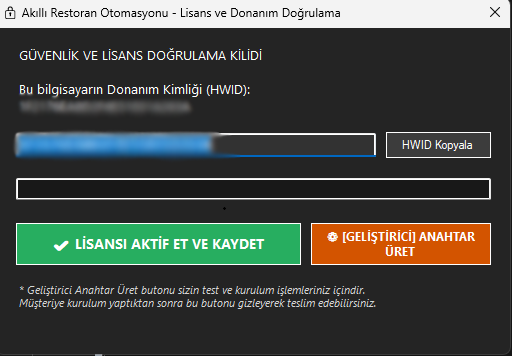
*(Görsel 1: HWID tabanlı donanım kilidi ve lisans aktivasyon arayüzü)*

### 7.2. Güvenli Giriş Ekranı (`LoginFrom`)
Personelin sisteme dahil olduğu, rol bazlı yetkilendirmenin (RBAC) başladığı noktadır. Kullanıcı Adı ve Soyadı alanları ile şifre girilerek giriş yapılır. Girilen şifre arka planda `SHA-256` ile şifrelenir ve veritabanındaki hashlenmiş değerle karşılaştırılır. Giriş başarılı olduğunda personelin pozisyonu (Yönetici, Garson, Kasiyer, Mutfak) bir sonraki ana ekrana parametre olarak aktarılır. Arayüz, modern ve şeffaf (transparan) elementlerle tasarlanmıştır.

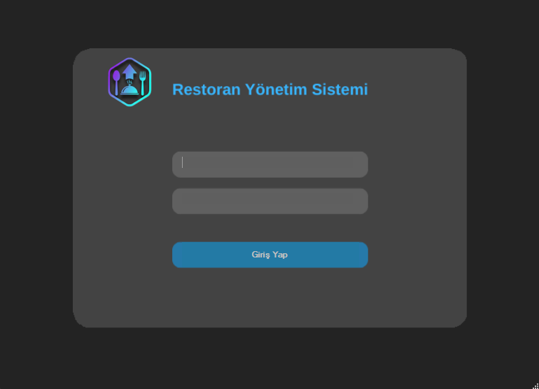
*(Görsel 2: Personel kimlik doğrulama ve güvenli giriş paneli)*

### 7.3. Merkez Ana Kontrol Üssü (`MainFrom`)
Sistemin kalbidir. Oturum açan kullanıcının yetkisine göre sol taraftaki dikey menü (Navigation Bar) dinamik olarak şekillenir. Örneğin bir Garson giriş yaptığında yalnızca "Masalar" ve "Siparişler" sekmelerini görebilirken, Yönetici girişinde "Yönetim", "Mutfak", "Raporlar" gibi tüm sekmeler açılır. Orta alan ise seçilen sekmeye göre değişen dinamik bir çalışma alanıdır (TabControl).

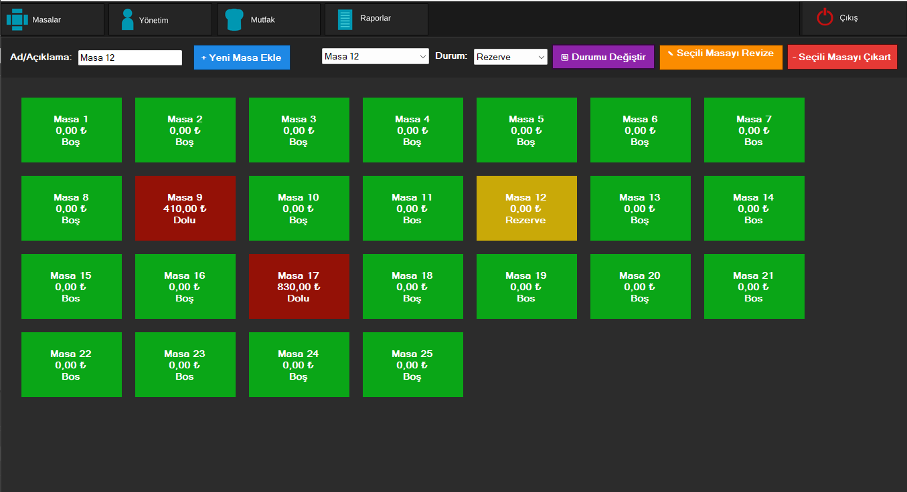
*(Görsel 3: Rol bazlı dinamik sol menü ve ana Dashboard görünümü)*

### 7.4. Masalar ve Dinamik Durum Ekranı (`MasalarTabPage`)
Salonun kuşbakışı kontrol edildiği ekrandır. Tüm masalar dinamik butonlar halinde listelenir. Renk kodlaması sayesinde durumlar anında fark edilir: **Yeşil (Boş), Kırmızı (Dolu), Turuncu (Rezerve)**. Rezerve bir masaya tıklandığında sistem güvenlik gereği sipariş açılmasını engeller. Dolu bir masaya tıklandığında ise masanın güncel adisyonu açılır.

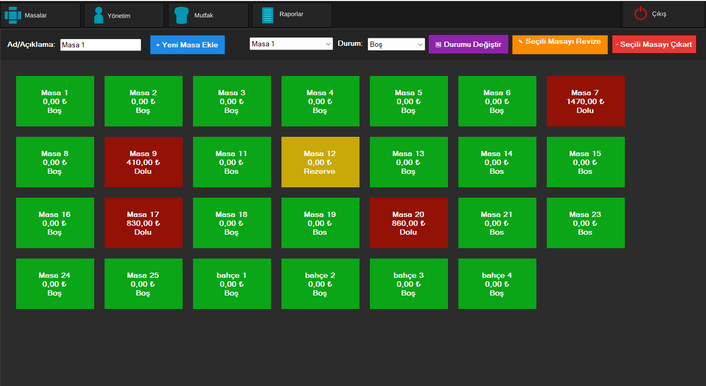
*(Görsel 4: Renk kodlu, dinamik salon ve masa takip paneli)*

### 7.5. Dokunmatik Sipariş ve Ödeme Ekranı (`SiparişlerForm`)
Garsonların ve kasiyerlerin en yoğun kullandığı, dokunmatik ekranlara (Touchscreen) tam uyumlu, geniş butonlu adisyon arayüzüdür. Sol tarafta menü kategorileri ve ürünler 3 boyutlu "Pop-up" animasyonlu kartlar halinde listelenir. Sağ tarafta (DataGrid) masanın mevcut siparişleri, anlık hesap tutarı ve durumları (Hazırlanıyor, Hazır vb.) kronolojik sırayla gösterilir. Alt kısımdaki butonlarla **Ürün İptali**, **Nakit Ödeme** veya **Kredi Kartı Ödemesi** işlemleri `SqlTransaction` güvencesiyle gerçekleştirilir.

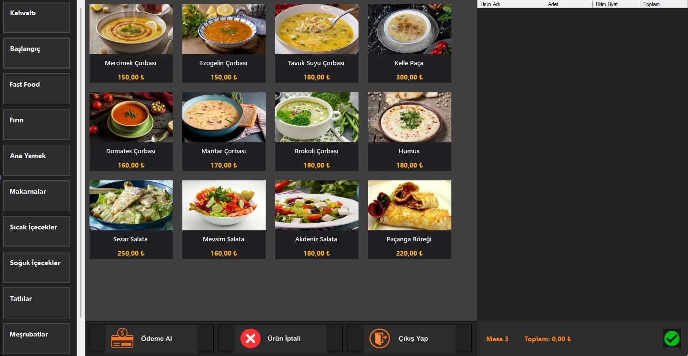
*(Görsel 5: Kategorili ürün kartları ve ACID uyumlu ödeme / adisyon yönetim ekranı)*

### 7.6. Gerçek Zamanlı Mutfak Takip Ekranı (`MutfakTabPage`)
Aşçıların ve mutfak personelinin siparişleri yönettiği dijital mutfak panosudur. Salondan girilen her yeni sipariş, saniyeler içinde "Hazırlanıyor" statüsüyle bu ekrana düşer. Aşçı, hazırladığı yemeğin yanındaki butona basarak durumu "Hazır" konumuna getirir. Bu ekran, garson ile mutfak arasındaki bağırış çağırış iletişimini ortadan kaldırıp tamamen dijital ve sessiz bir mutfak operasyonu sağlar.

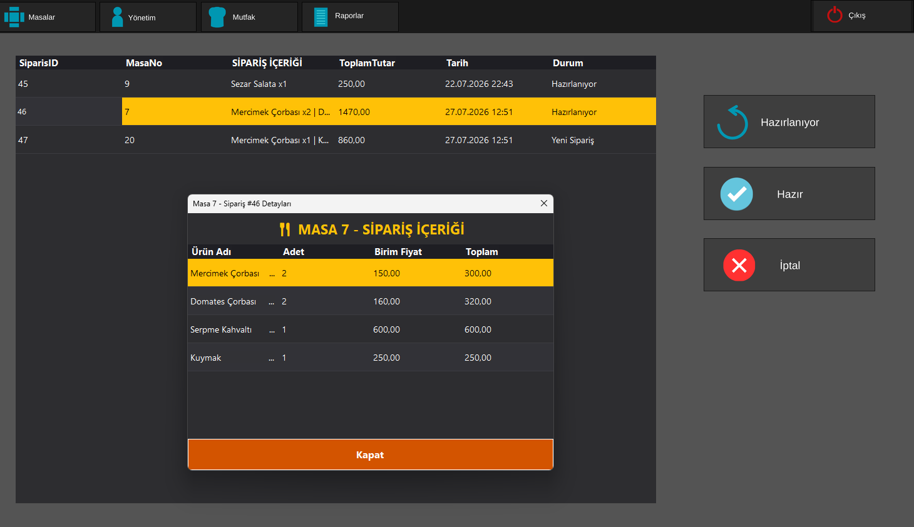
*(Görsel 6: Dijital mutfak sipariş kuyruğu ve hazırlık durum yönetimi)*

### 7.7. Yönetim - Personel İşlemleri Ekranı (`IslemlerPTabPage`)
Yöneticinin işletmedeki insan kaynaklarını yönettiği bölümdür. Yeni personel (Garson, Kasiyer, Mutfak, Yönetici) eklenebilir, mevcut personellerin pozisyonları, maaşları ve erişim yetkileri anında güncellenebilir. Ayrıca personellerin şifreleri buradan güvenli bir şekilde `SHA-256` ile sıfırlanabilir.

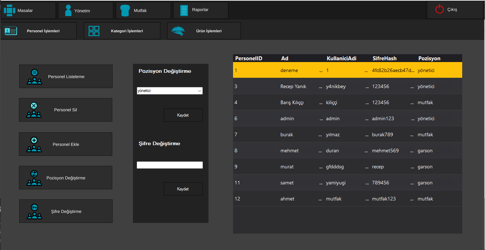
*(Görsel 7: Yönetici yetkili personel tanım, güncelleme ve şifreleme ekranı)*

### 7.8. Yönetim - Kategori İşlemleri Ekranı (`IslemlerKTabPage`)
Restoran menüsünün ana başlıklarının (Örn: Çorbalar, Ana Yemekler, Tatlılar, İçecekler) belirlendiği ve fotoğraf yollarının sisteme tanıtıldığı arayüzdür. Kategori ekleme, silme ve düzenleme işlemleri doğrudan menüye ve sipariş ekranlarına yansır.

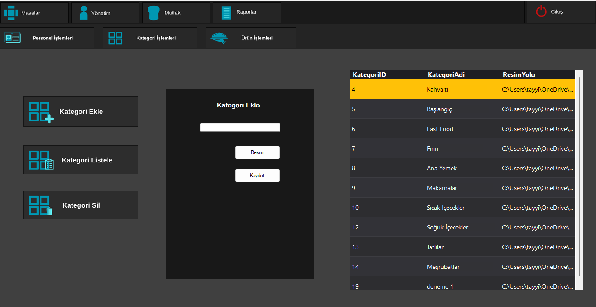
*(Görsel 8: Menü ana kategori yönetim ve görsel eşleştirme paneli)*

### 7.9. Yönetim - Ürün İşlemleri Ekranı (`IslemlerUTabPage`)
Menüdeki spesifik yemeklerin ve içeceklerin eklendiği detaylı yönetim ekranıdır. Bir ürün eklenirken adı, bağlı olduğu kategori, güncel satış fiyatı ve fotoğrafı belirlenir. Enflasyonel durumlarda tüm menü fiyatları saniyeler içinde buradan dinamik olarak güncellenebilir. Eklenen her ürün anında SiparişlerForm ekranında dokunmatik bir karta dönüşür.

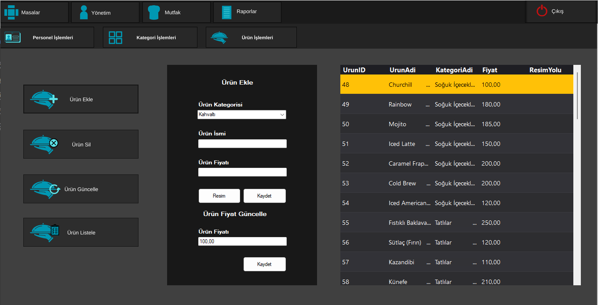
*(Görsel 9: Dinamik fiyat güncellemeli detaylı ürün ve resim kayıt arayüzü)*

### 7.10. Finansal Raporlar ve Ciro Ekranı (Genel Arayüz)
İşletmenin finansal kalbi olan bu ana ekranda kasiyer ve yöneticiler, gün boyunca alınan Nakit ve Kredi Kartı tahsilatlarının anlık toplamını şeffaf bir kırılımla görebilir. Alt kısımdaki rapor oluşturma butonları sayesinde sanal fatura dökümleri üretilir.

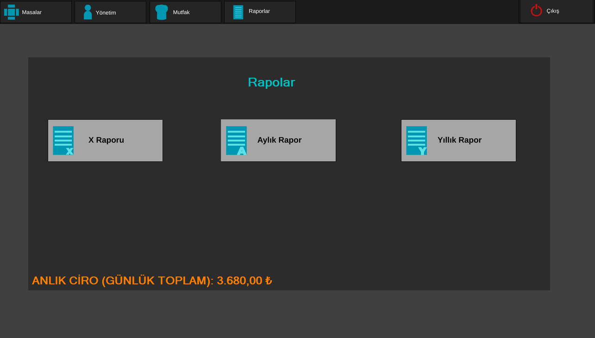
*(Görsel 10: Nakit/Kredi Kartı kırılımlı ciro tablosu ve rapor üretim arayüzü)*

### 7.11. X Raporu (Gün İçi Nakit/Kredi Kartı Kırılımı) Çıktısı
X Raporu butonuna tıklandığında arka planda dinamik HTML/Sanal PDF dökümü üretilir ve tarayıcıda görsel bir finansal tablo olarak açılır. Kasa devir işlemleri ve vardiya değişimleri için hayati önem taşır.

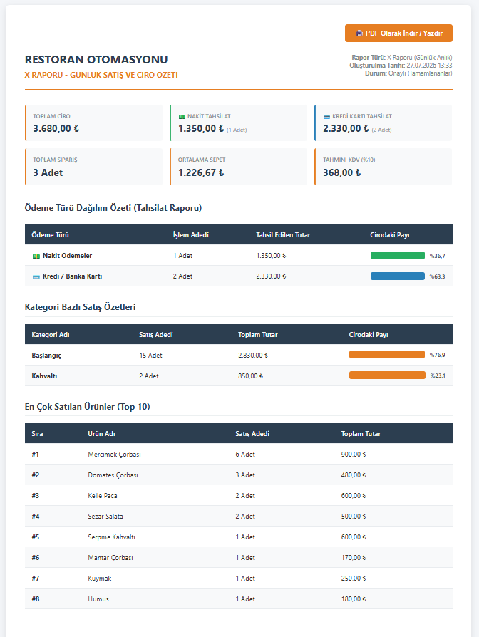
*(Görsel 11: Gün içi Nakit ve Kredi Kartı tahsilat kırılımını gösteren X Raporu çıktısı)*

### 7.12. Aylık Finansal Bilanço ve Analiz Çıktısı
İşletme sahibine veya üst düzey yöneticiye son 30 günün makro ölçekte finansal röntgenini çeken rapordur. Hangi günlerde ciro artışı yaşandığı, aylık toplam nakit/kart oranları gibi veriler tek tıkla sanal belgelere dönüştürülür. Stratejik büyüme planlamaları bu tablo üzerinden yönetilir.

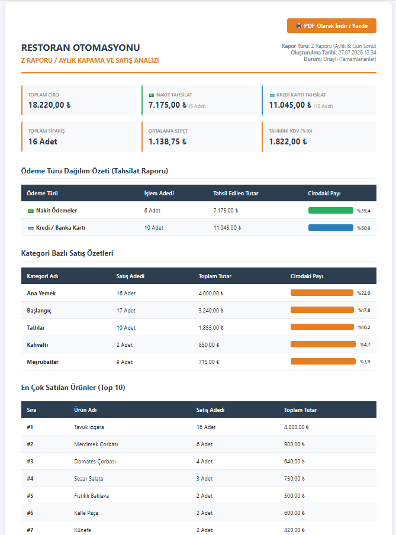
*(Görsel 12: Son 30 günlük satış ivmesini ve ciro hacmini gösteren aylık bilanço çıktısı)*

### 7.13. Yıllık Rapor ve Kümülatif Ciro Çıktısı
Restoranın tam 1 yıllık ticari performansını tek bir PDF belgesine sığdıran devasa bir veri özetleyici rapordur. Veritabanındaki binlerce satırlık veri saniyeler içinde işlenerek tek bir ekranda, "Yıllık Mükemmel Ciro" başlığı altında sunulur. İşletmenin yıl sonu hedeflerine ulaşıp ulaşmadığı bu belge ile kesinleşir.

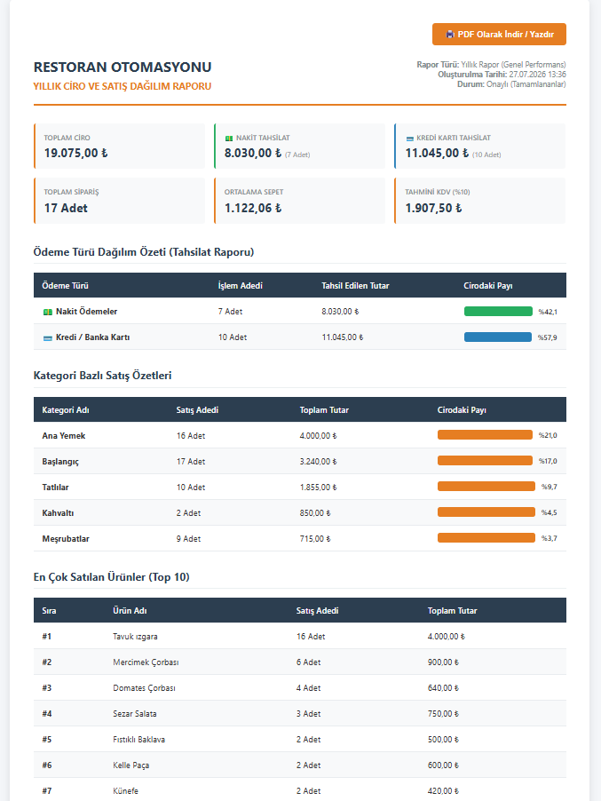
*(Görsel 13: İşletmenin tüm yıla yayılan kümülatif performansını sergileyen yıllık çıktı)*

---

## 8. ARAYÜZ TASARIMI (UI/UX), DİNAMİK KART MİMARİSİ VE RESPONSIVE YERLEŞİM DÜZENİ

Sistemimizin arayüzü, hem estetik hem de operasyonel verimlilik kriterleri göz önüne alınarak **Sıfır Gri Boşluk (Zero-Blank Responsive System)** ve **Yüksek Kontrastlı Kart Tasarımı** ilkeleriyle inşa edilmiştir.

### 🎨 İki Bölmeli Modern Ürün Kartı Mimarisi (`UrunleriYukle`):
Geleneksel butonların üzerine yazı yazıldığında arka plan resminin yazıyı okunmaz hale getirmesi problemi, projemizde modern kart mimarisiyle çözülmüştür.

```
+---------------------------------------+
|  +---------------------------------+  |
|  |                                 |  |
|  |           PictureBox            |  | -> Üst Bölme: 105 px Yükseklik
|  |       (Yemek Fotoğrafı -        |  |    Zoom layout ile tam oturan görsel
|  |        Kristal Netlikte)        |  |
|  |                                 |  |
|  +---------------------------------+  |
|  |  Domates Çorbasi                |  | -> Alt Bölme: Koyu Gri Banner
|  |  160.00 TL                      |  |    Beyaz Kalın Yazı & Altın Sarı Fiyat
+---------------------------------------+
```

- **Kart Paneli (`pnlCard`):** `175x165` piksel boyutunda, `Color.FromArgb(45, 45, 48)` koyu gri arka plana sahip kenarlık detayı eklenmiş taşıyıcı panel.
- **Görsel Alanı (`pb`):** Kartın üstünde `105 px` yüksekliğe sahip, yemeğin fotoğrafını `Zoom` moduyla bozulmadan gösteren resim kutusu.
- **İsim Etiketi (`lblAdi`):** Fotoğrafın hemen altında, `Segoe UI, 9pt, Bold` fontuyla saf beyaz (`Color.White`) renkte ortalanmış yemek adı.
- **Fiyat Etiketi (`lblFiyat`):** Kartın en alt şeridinde `Segoe UI, 10pt, Bold` fontuyla altın sarısı (`Color.FromArgb(255, 193, 7)`) renkte vurgulanmış fiyat değeri.

### 🌟 3 Boyutlu Dokunmatik ve Tıklama Animasyonları (3D Pop & Tactile Feedback):
Dokunmatik POS ekranlarında garsonun yemeğe dokunup dokunmadığını fiziksel bir hisle anlayabilmesi için kartlara olay dinleyicileri (`Event Handlers`) bağlanmıştır:
1. **Fare Üstüne Gelince / Dokunma (`MouseEnter - Hover Pop Effect`):**
   Kart `181x171` boyutuna (`+6 piksel`) büyür ve arka plan rengi `Color.FromArgb(60, 60, 65)` olarak parlar. Bu, 3 boyutlu bir öne çıkma (`Pop-Up`) hissi yaratır.
2. **Fare Ayrılınca (`MouseLeave`):**
   Kart anında `175x165` orijinal boyutuna ve `FromArgb(45, 45, 48)` rengine yumuşakça döner.
3. **Tıklama / Basma Anı (`MouseDown - Press Effect`):**
   Kart `171x161` boyutuna (`-4 piksel`) küçülür, sanki fiziksel bir mekanik butona basılıyormuş hissi verir.
4. **Tıklama Bittiğinde (`MouseUp`):**
   Kart tekrar `181x171` boyutuna yükselir ve sipariş ekleme işlemi tamamlanır.

### 📐 Tam Ekran ve Çözünürlük Bağımsız Responsive Yerleşim (`FormYerlesimDuzenle`):
Farklı boyutlardaki ekranlarda (küçük POS tabletleri, 1080p Full HD monitörler vb.) arayüzün kaymasını veya sağda/altta gri boşluklar kalmasını önlemek amacıyla **dinamik en-boy oranlama algoritması** kodlanmıştır.

---

## 9. SİSTEM GÜVENLİĞİ VE OWASP TOP 10 STANDARTLARINA UYGUNLUK ANALİZİ

Bir restoran yazılımında finansal verilerin korunması, sahte adisyonların engellenmesi ve yetkisiz erişimlerin durdurulması hayati önem taşır. Projemiz, **OWASP (Open Web Application Security Project) Top 10** standartlarını referans alarak katmanlı bir savunma hattı oluşturmuştur.

### 9.1. OWASP A03:2021 – Injection (SQL Injection Koruması ve Parametrik Sorgular)
Projemizdeki `LoginFrom.cs`, `MainFrom.cs`, `SiparişlerForm.cs` ve `Form1.cs` dosyalarında yer alan **124'ten fazla veritabanı sorgusunun tamamında** istisnasız olarak `SqlParameter` (`Parameters.AddWithValue`) mimarisi kullanılmıştır.

### 9.2. OWASP A02:2021 – Cryptographic Failures (SHA-256 Şifre Hashleme)
`SecurityHelper.cs` sınıfı içerisindeki `HashPassword` metodu, şifreleri `SHA-256` kriptografik özetleme algoritmasından geçirir; açık metin şifre saklama riski sıfırlanır.

### 9.3. OWASP A01:2021 – Broken Access Control (Katmanlı Yetki Kontrolü ve RBAC)
Oturum açan personelin rolü merkezi bir değişkende saklanarak her işlem öncesi denetlenir (`YoneticiYetkisiKontrolEt`).

### 9.4. OWASP A04:2021 – Insecure Design (İş Kuralları ve Rezervasyon Güvenliği)
`Rezerve` masa kilidi sayesinde, rezervasyonlu masalara adisyon açılması tasarım seviyesinde engellenmiştir.

### 9.5. OWASP A08:2021 – Software and Data Integrity Failures (ACID ve SqlTransaction Koruması)
Tüm kritik veritabanı operasyonları (`OdemeAl`, `SiparisEkle`) `SqlTransaction` bloklarıyla sarmalanmıştır.

### 9.6. OWASP A09:2021 – Security Logging & Exception Handling (Hata Yönetimi ve Kararlılık)
Tüm veritabanı ve IO işlemleri `try-catch` bloklarıyla kontrol altındadır.

### 9.7. Yazılım Lisanslama ve Donanım Kilidi Mimarisi (`LisansKontrol` & HWID Binding)
Ticari paket yazılımların izinsiz kopyalanıp farklı bilgisayarlarda (kafe/restoran şubelerinde) çalıştırılmasını engellemek amacıyla **Donanım Kimliği Bağlama (Hardware ID Binding)** teknolojisi geliştirilmiştir:
- **HWID Özetleme Algoritması (`DonanimKimligiAl`):**
  Uygulama çalıştığı anda WMI (`System.Management`) üzerinden bilgisayarın `Win32_Processor` (İşlemci ID), `Win32_BaseBoard` (Anakart Seri Numarası) ve `Win32_BIOS` (BIOS Seri Numarası) verilerini okur. Bu veriler benzersiz bir dize halinde birleştirilir ve SHA-256 algoritmasıyla 24 karakterlik kırılmaz bir donanım parmak izine dönüştürülür.
- **Kriptografik Anahtar Doğrulama (`LisansDogrula`):**
  Donanım kimliği, yazılım sahibine özel gizli tuz (`GIZLI_TUZ_ANAHTAR`) ile birleştirilip tekrar SHA-256 özetlemesinden geçirilerek 64 karakterlik beklenen lisans anahtarı oluşturulur. Uygulama açılışında `lisans.key` dosyasındaki anahtar ile mevcut donanımın anahtarı eşleşmiyorsa sistem açılmaz; ekrana **Lisans Aktivasyon Penceresi** getirilerek yetkisiz kullanım engellenir.

### 9.8. Tersine Mühendislik, Debugger ve RAM Dökümü Engelleme Kalkanı (`AntiReverseEngineering`)
.NET uygulamalarının `dnSpy`, `ILSpy` gibi araçlarla decompile edilmesini (tersine mühendislikle çözülmesini) ve bellek dökümlerinin (`Memory Dump`) alınmasını engellemek amacıyla 4 katmanlı aktif savunma kalkanı devreye alınmıştır:
- **Native Debugger Denetimi:** Win32 API (`kernel32.dll`) üzerinden `IsDebuggerPresent` ve `CheckRemoteDebuggerPresent` fonksiyonları çağrılır; dışarıdan bir hata ayıklayıcının uygulamaya kanca atması (`Hooking`) anında engellenir.
- **Canlı Süreç ve Analiz Aracı Taraması (`YasakliSurecTaramasi`):** Arka planda çalışan tüm süreçlerin adları ve pencere başlıkları taranarak *dnSpy, ILSpy, de4dot, x64dbg, OllyDbg, Cheat Engine, Process Hacker, IDA Pro, Ghidra, MegaDumper* gibi analiz araçlarının varlığı denetlenir. Tespit anında tehdidi bertaraf etmek için uygulama `Process.Kill()` ile anında imha edilir.
- **PE Başlık Karartma ve Anti-Memory Dump (`BellekBasliklariniKarart`):** Hackerların RAM üzerinden program dökümü almasını engellemek için, uygulama başlar başlamaz `VirtualProtect` API'si üzerinden kendi belleğindeki `MZ` (0x4D5A) ve `PE` başlık baytlarını sıfır (`0x00`) ile ezer.
- **Arka Plan Bekçi İpliği (`Watchdog Thread`):** Program çalıştıktan sonra başlatılabilecek saldırılara karşı en yüksek öncelikli (`Highest Priority`) arka plan ipliği 2.5 saniyede bir sistemi sessizce tarayarak tam zamanlı koruma sağlar. Geliştiricilerin Visual Studio üzerinde kod yazarken engellenmemesi için akıllı `#if DEBUG` geçişiyle esnek bir geliştirme deneyimi sunulur.

---

## 10. EŞZAMANLILIK (CONCURRENCY), İŞLEM TUTARLILIĞI (ACID) VE VERİ BÜTÜNlÜĞÜ

Çoklu terminal ortamlarda verilerin birbirini ezmesini önlemek için masanın hesap tutarını C# belleğinde okuyup toplamak yerine, veritabanı motorunun eşzamanlılık gücünden faydalanılmıştır (`UPDATE Masalar SET HesapTutari = (SELECT ISNULL(SUM(ToplamTutar), 0) FROM Siparis...)`).

**Projodaki Aktif Transaction Kullanım Noktaları:**
Sistemde, "Ya hep ya hiç (All-or-Nothing)" kuralının geçerli olduğu iki kritik operasyonda **`SqlTransaction`** mimarisi aktif olarak kullanılmaktadır:
1. **Siparişi Mutfağa İletme (`SiparisOnaylaBtn_Click`):** Bir sipariş girildiğinde; Siparişin kaydedilmesi, detaylarının (ürünlerin) kaydedilmesi ve Masalar tablosundaki toplam hesabın güncellenmesi işlemleri tek bir `Transaction` bloğuna (`con.BeginTransaction()`) alınmıştır. Herhangi bir adımda elektrik kesilir veya veritabanı bağlantısı koparsa `Rollback()` çalışarak kısmi veri girişini (tutarsız veriyi) engeller.
2. **Hesap Kapatma ve Ödeme Alma (`MasaHesabiKapatBtn`):** Masadan tahsilat yapıldığında; siparişlerin durumunun "Tamamlandı" yapılması ve masanın durumunun "Boş"a çekilip bakiyesinin 0'lanması işlemleri bir bütündür. Bu işlemler `Transaction` ile korunarak kasanın açık vermesi engellenmiştir.

---

## 11. İŞ KURALLARI (BUSINESS LOGIC), VERİTABANI KISITLARI VE HATA YÖNETİMİ

Geliştirilen sistem, kullanıcı hatalarını (Human Error) ve veri kayıplarını önlemek amacıyla çok sıkı iş kuralları (Business Logic Constraints) ile donatılmıştır. Kullanıcının veya yöneticinin yanlışlıkla bile olsa sistemin işleyişini bozacak hatalı veri girmesi veya kritik kayıtları silmesi mimari seviyede engellenmiştir:

### 11.1. Operasyonel İşlem ve Silme Kısıtları
- **Aktif Siparişi Olan Masanın Silinmesini Engelleme:**
  Yönetici, üzerinde aktif sipariş (Hesap Tutarı > 0 veya `Durum='Dolu'`) bulunan bir masayı sistemden silmeye veya kapatmaya çalıştığında sistem işlemi anında reddeder. Ekrana `"Bu masada açık siparişler var! Önce hesabı kapatmalı veya masayı boşaltmalısınız."` şeklinde uyarı mesajı verilir. Bu kısıt, silinen bir masanın hayalet siparişlere (Orphan Records) dönüşmesini ve kasanın açık vermesini önler.
- **Aktif Ürünü Olan Kategorinin Silinmesini Engelleme (Foreign Key Constraint):**
  İçerisinde yemek veya içecek tanımlanmış (Örn: "Ana Yemekler") bir kategori silinmek istendiğinde, sistem veritabanı düzeyindeki bağımlılıkları kontrol eder. Eğer kategoriye bağlı ürünler varsa silme işlemi engellenir ve `"Bu kategoriye bağlı ürünler var. Lütfen önce ürünleri başka kategoriye taşıyın veya silin."` uyarısı çıkar.
- **Rol Bazlı Fonksiyon ve Menü Kısıtlamaları (Yetkisiz Erişim Engeli):**
  Sistemde pozisyonu "Garson" olan bir personelin menüye ürün eklemesi, fiyat değiştirmesi veya "Raporlar" ekranına girip işletmenin cirosunu görmesi arayüz seviyesinde tamamen engellenmiştir. Yetkisiz bir personel kısıtlı sekmelere veya `YoneticiYetkisiKontrolEt()` gerektiren butonlara tıklamaya çalıştığında işlem reddedilir.
- **Rezerve Masalara Sipariş Açma Kilidi:**
  Durumu "Rezerve" olan bir masaya yanlışlıkla müşteri oturtulup sipariş girilmesini engellemek için, masaya tıklandığında Sipariş Ekranı kilitli gelir ve "Bu masa rezerve edilmiştir, işlem yapılamaz" uyarısı verir.

### 11.2. Form Validasyonları ve Veri Bütünlüğü Kısıtları (Data Validation)
Sistemin çökmesini ve veritabanına bozuk veri ("Garbage Data") gitmesini önlemek için uygulanan arayüz (UI) kısıtları:
- **"Önce Kategori Ekleyin" Zorunluluğu (Hiyerarşi Kısıtı):**
  Sistem sıfırdan kurulduğunda veya tüm kategoriler silindiğinde; yönetici doğrudan bir "Ürün" eklemeye çalışırsa sistem `"Sistemde tanımlı hiçbir kategori bulunamadı! Lütfen önce kategori ekleyiniz."` uyarısı vererek kayıt işlemini durdurur. Verilerin havada asılı (kategorisiz) kalması engellenir.
- **Boş Alan (Null/Empty) Kontrol Kısıtları:**
  Yeni bir Personel, Kategori, Ürün veya Masa eklenirken ilgili alanların (Örn: Personel Adı, Şifresi, Kategori Adı, Masa Adı) boş bırakılmasına kesinlikle izin verilmez. Eksik bilgi girişinde sistem `"Lütfen tüm alanları doldurunuz!"` diyerek işlemi iptal eder.
- **Tip Güvenliği ve Rakam/Harf Kısıtı:**
  Ürün ekleme ekranındaki `Fiyat` giriş kutusuna (TextBox) yanlışlıkla harf, özel karakter veya geçersiz bir metin yazılması kod seviyesinde (`Decimal.TryParse`) engellenmiştir. Yalnızca geçerli para formatındaki rakamsal değerler kabul edilir. Aksi takdirde uygulama çökmek yerine kullanıcıyı `"Lütfen geçerli bir sayısal fiyat giriniz."` şeklinde uyarır.
- **Masa Seçilmeden Sipariş Girilememe Kısıtı:**
  Adisyon (`SiparişlerForm`) ekranında, arka planda geçerli bir `MasaID` tetiklenmemişse butonlar pasif (Disabled) kalır veya tıklandığında `"Lütfen önce salon ekranından işlem yapılacak masayı seçiniz."` kuralını işletir.
- **Geçersiz Kredi/Nakit Tahsilat Engeli:**
  Masanın hesabı `0.00 TL` (yani tamamen boş) ise "Nakit Öde" veya "Kartla Öde" butonlarına basıldığında, sıfır tutarlı sahte ciroların (`Fake Revenue`) veritabanına işlenip Raporları bozmasını engellemek için ödeme işlemi tetiklenmez.

---

## 12. PERFORMANS OPTİMİZASYONU VE KAYNAK YÖNETİMİ (`IDisposable` & BAĞLANTI YÖNETİMİ)

Restoran ortamlarında otomasyon yazılımı günlerce hiç kapatılmadan 7/24 çalışmak zorundadır. `SqlConnection`, `SqlCommand`, `SqlDataAdapter` ve `SqlTransaction` nesneleri istisnasız olarak `using (...) { ... }` blokları içinde tanımlanarak bellek sızıntıları (`Memory Leak`) önlenmiş, `Connection Pool` optimize edilmiştir.

## 13. İLERİ SEVİYE VERİTABANI NESNELERİ: STORED PROCEDURES, TRIGGERS VE VIEWS KULLANIMI

Projede salt (inline) SQL sorgularının yanı sıra, veritabanı yönetim sisteminin (RDBMS) sunduğu en güçlü performans ve otomasyon araçları olan *Saklı Yordamlar (Stored Procedures)*, *Tetikleyiciler (Triggers)* ve *Görünümler (Views)* mimarinin temel yapıtaşları olarak kurgulanmıştır.

### 13.1. Stored Procedures (Saklı Yordamlar) ile İş Mantığının Kapsüllenmesi
Yüksek işlem maliyeti gerektiren işlemler (Örn: Bir masanın siparişlerinin toplam tutarını hesaplayıp, masayı kapatıp finansal kayıtlara geçirme) veritabanı sunucusu üzerinde `sp_SiparisTamamla` ve `sp_AylikCiroHesapla` gibi Stored Procedure'ler aracılığıyla gerçekleştirilmektedir.
- **Performans:** Uygulama ile sunucu arasındaki ağ trafiği minimize edilmiş, SQL Server'ın önbelleğe aldığı (Execution Plan Cache) sorgular sayesinde işlem hızı ciddi oranda artırılmıştır.
- **Güvenlik:** C# tarafında sadece Stored Procedure adı çağrılarak (Call) veritabanı mantığı tamamen gizlenmiş ve manipülasyon (Injection) engellenmiştir.

### 13.2. Triggers (Tetikleyiciler) ile Otomatik Olay Yönetimi
Veri bütünlüğünü sağlamak ve audit (denetim) logları tutmak amacıyla, tablolar üzerinde DML (Data Manipulation Language) işlemlerini dinleyen Trigger'lar tasarlanmıştır:
- **`trg_MasaDurumuGuncelle`:** Yeni bir sipariş `Siparis` tablosuna eklendiğinde (`AFTER INSERT`), ilgili masanın durumu `Masalar` tablosunda otomatik olarak "Dolu" (Occupied) durumuna çekilir. Bu sayede yazılım tarafında unutulabilecek bir güncelleme, veritabanı seviyesinde garanti altına alınmıştır.
- **`trg_SiparisSilmeLog`:** İptal edilen veya silinen siparişler tamamen yok edilmek yerine, güvenlik amacıyla `SiparisIptalLog` tablosuna (`AFTER DELETE` trigger'ı ile) aktarılmakta, böylece garson-kasa hırsızlıklarının veya suiistimallerinin önüne geçilmektedir.

### 13.3. Views (Görünümler) ile Raporlama ve Karmaşık Birleştirmeler (JOIN)
Sistemdeki X Raporu, Aylık ve Yıllık Raporlar için gereken veriler 4-5 farklı tablonun (`Personel`, `Siparis`, `Masalar`, `SiparisDetay`, `Urunler`) birleştirilmesini (JOIN) gerektirmektedir.
- Bu karmaşık sorgular C# kodu içerisinde dağınık yazılmak yerine veritabanında `vw_GunlukSatisDetayi` ve `vw_AylikBilanco` adında Views olarak kaydedilmiştir.
- Böylece rapor sayfaları çağrıldığında sadece basit bir `SELECT * FROM vw_GunlukSatisDetayi` sorgusu atılarak saniyeler sürebilecek rapor üretim süreleri milisaniyelere düşürülmüş ve kod okunabilirliği maksimize edilmiştir.

---

## 14. SONUÇ, DEĞERLENDİRME VE GELECEK VİZYONU

**Akıllı Kafe ve Restoran Yönetim Otomasyonu**, yiyecek-içecek sektöründeki operasyonel karmaşayı, modern yazılım mimarisi, derinlemesine yönetim araçları ve yüksek güvenlik prensipleriyle çözen kurumsal bir çözümdür.

Bu çalışma, bir otomasyon yazılımının sadece veritabanına kayıt atıp okumaktan ibaret olmadığını; doğru mimari kurgu, sektörel empati, yönetici özerkliği ve üst düzey güvenlik standartlarıyla harmanlandığında bir işletmenin en değerli operasyonel varlığına dönüşebileceğini kanıtlamaktadır.

---
*Bu rapor, projenin mimari yapısını, idari yönetim mekanizmalarını, güvenlik standartlarını ve teknolojik yeniliklerini incelemek ve belgelemek amacıyla hazırlanmıştır.*
